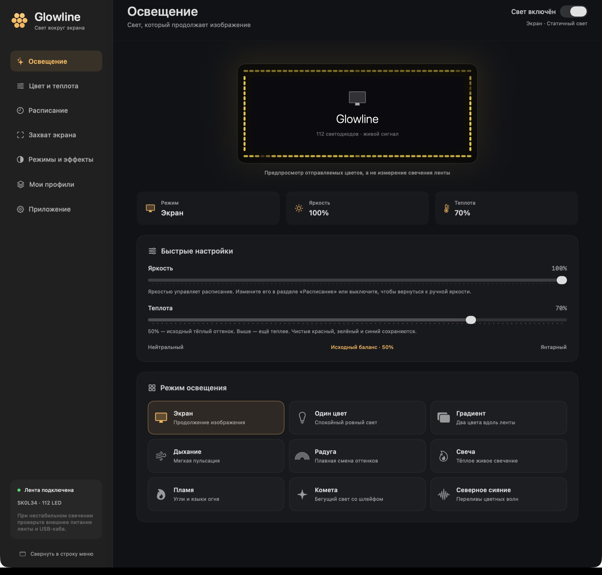

# Glowline — подсветка монитора для macOS

Glowline подстраивает подсветку **Skydimo SK0L34 на 112 светодиодов** под цвета по краям экрана. Работает из строки меню macOS, с русским интерфейсом и локальными настройками.

**[Скачать Glowline 1.2.0 для macOS](https://github.com/hardcodd/Glowline/releases/latest)** · [Руководство](РУКОВОДСТВО.md) · [English](README.en.md)

*Версия 1.2.0: расписание, девять режимов подсветки и встроенный ночник. Контур показывает отправляемые цвета.*

## Что нужно для macOS

Mac с **Apple Silicon и macOS 15+**, USB-контроллер **Skydimo SK0L34** и лента с фиксированной схемой на **112 LED**. Intel Mac и другие модели/длины ленты не поддерживаются. Проверена одна физическая конфигурация; подробности — в [руководстве](РУКОВОДСТВО.md#подходящая-лента).

## Быстрый запуск на macOS

1. Скачайте ZIP или DMG и скопируйте `Glowline.app` в `~/Applications/`.
2. Откройте приложение. Если macOS блокирует запуск, следуйте [инструкции установки](docs/INSTALL.ru.md#первый-запуск-без-сертификата-apple-developer-id): сборка подписана ad-hoc, без нотарификации Apple.
3. Завершите другие программы управления лентой и выберите USB-порт в разделе **Приложение**.
4. Для режима **Экран** разрешите запись экрана в настройках macOS. Остальные режимы работают без этого доступа.

Закрытие окна оставляет подсветку работающей. Настройки открываются через значок Glowline в строке меню; полный выход — **Command-Q**.

## Что умеет

Версия 1.2.0 включает следующие возможности.

- **Девять режимов:** экран, один цвет, градиент, дыхание, радуга, свеча, пламя, комета и северное сияние.
- **Встроенный ночник Noctiluca на macOS:** полноэкранная анимация на Metal. Запуск из меню Glowline или раздела «Приложение», без браузера и отдельной установки.
- **Цвет и теплота:** яркость, насыщенность, гамма и коррекция отдельных сторон.
- **Детализация цвета:** переключаемый выбор ведущих оттенков для сравнения со стандартным усреднением.
- **Расписание яркости:** своё время начала дня и ночи и яркость каждого периода. Изначально выключено; время можно менять по сезону.
- **Свои настройки эффектов:** цвета, движение и характер свечения запоминаются отдельно для каждого режима.
- **Профили:** сохранение удачных настроек, импорт и экспорт JSON.
- **Светлое, тёмное и системное оформление**, автозапуск и управление из строки меню.

Текущие настройки **сохраняются автоматически**, даже после полного выхода. Профиль — отдельный снимок: после подстройки сохраните его заново, если хотите обновить. Обновление приложения сохраняет настройки и профили.

## Инструкции и помощь

[Полное руководство](РУКОВОДСТВО.md) · [Установка и обновление](docs/INSTALL.ru.md) · [Что нового в 1.2.0](docs/RELEASE-1.2.0.ru.md) · [Сообщить об ошибке](https://github.com/hardcodd/Glowline/issues)

Для проверки цветов скачайте и откройте в браузере [тест подсветки](docs/lighting-test.html): он работает без интернета и подстраивается под широкие мониторы. `F` — весь экран, пробел — пауза, `H` — скрыть управление.

Исходники и [сборка приложения](РУКОВОДСТВО.md#сборка-из-исходников) доступны по лицензии [MIT](LICENSE). Glowline — независимый проект, не официальное приложение Skydimo. Снимки экрана и звук не сохраняются и никуда не отправляются.
